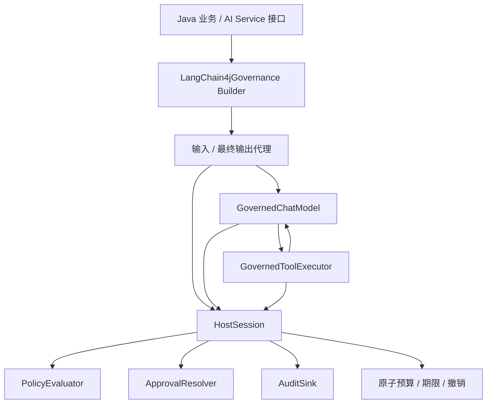
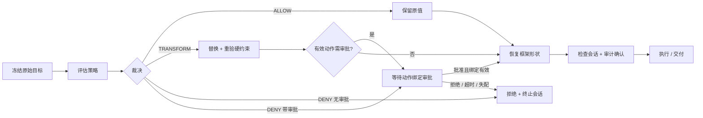

# 架构与扩展契约

## 设计依据与取舍

微软 AGT 的 Framework Adapter Contract 要求适配器通过 HostSession 介导生命周期，副作用/披露之前落实改写，计数留在宿主。Java 版沿用这些行为语义，保持治理核心不依赖框架。

参考版本为微软 AGT v5.0.0，源码修订记录在仓库 NOTICE。AI 架构建议中的 Spring AI 优先、FFI 自动达到全部规范兼容、固定性能数字和跨语言哈希互通均未作为实现承诺。

| 技术 | 用途与选择理由 | 取舍 |
|---|---|---|
| Java 17 | 与 LangChain4j 基线一致，使用 record 等稳定功能 | 不要求 JDK 21 preview ScopedValue、FFM 或模式 switch |
| Maven | 核心/框架适配/示例独立制品 | 少量模块，避免提前拆出多个后端 |
| Jackson JSON/YAML | 成熟解析库，显式重复键、深度、类型和字段验证 | 规则格式独立，不声称完整 JSON Schema 或 ACS manifest 兼容 |
| 原生接口装饰器 + JDK Proxy | 注册受控模型、工具与 AI Services 方法 | 接入需改构建代码，不保护任意原始引用 |
| ThreadLocal + 显式 HostSession | 同步线程内会话绑定，finally 清理 | v0.2 管理的 future 和工具调度传播上下文；宿主任务仍需显式接入 |
| 有限审批线程池 + CompletionStage | 同步审批实现也能有界等待，支持取消 | 不能杀死不响应中断的插件；容量满则拒绝 |
| 同步 JSONL sink | 写入确认和故障关闭清晰 | 不承诺 fsync、恢复、轮转或防篡改 |

现有 langchain4j-runtime-security 用布尔裁决进行检测阻断，Java AGT 需要改写和审批，因此独立实现核心，复用设计经验而非套用旧内核。未复制微软或参考项目源文件。

## 依赖与调用链

Builder 先包装模型与所有注册工具，再构建原生 AiServices，最后代理业务接口的 input/output。工具前后模型调用继续走同一模型装饰器。动态 ToolProvider 的每次结果也重新包装，保留 ReturnBehavior。禁止将现有已构建代理包装一下就称为完整覆盖。

高级装饰器需要当前线程已绑定会话。没有会话时拒绝；同 runtime 不同线程可有独立会话。HostSession 的预算操作同步保护，策略无会话状态。

## 裁决执行

JSON 目标经过深度不可变快照。可信身份、会话和策略版本不属于可改写目标。模型消息的 role、name、工具调用 ID/名称与消息数量也是不可改写元数据；不匹配时拒绝，不能回退原值。

工具参数先检查授权与 schema，再改写，之后重验。模型请求使用实际消息投影，不只检查 user prompt。AI thinking、消息 attributes、工具调用参数与文本返回都进入检查。工具结果同时检查 resultText、String result 和 JSON attributes；不允许复杂对象或多模态结果绕过。

模型/工具额度先原子预占。纯形状恢复在真实 delegate 执行标记之前完成，失败释放预占；真正开始执行后不因失败退款。provider token 使用量在返回检查之前入账，缺失使会话总量变为未知。

安全拒绝保留首次 failureCode 并终止会话。框架可能把异常转换为工具文本，但下一次模型调用、工具调用或最终输出检查仍拒绝。拒绝并非依赖模型遵守「不要重试」这句话。

## SPI 契约

PolicyEvaluator 提供不可变 version、interventionPoints、evaluate；validateEffective 验证有效目标；requiresApproval 保证改写不跳过审批。自定义实现必须线程安全，并遵守稳定 reasonCode、不返回敏感消息的约定。策略本身若使用 I/O，应自行限定请求和运行时间；本期不对任意同步策略实现提供强制执行超时。

ApprovalResolver 返回 CompletionStage。请求绑定 sessionId、actionId、干预点、工具名、可信身份/权限、策略版本和有效目标的摘要；每次使用新 requestId，批准结果必须匹配两个标识。执行前重新核对摘要、有效目标、会话及策略版本。摘要仅在本项目内稳定，不声称跨语言 canonical JSON 标准。

AuditSink.write 同步确认；异常导致 runtime 级粘滞故障，所有会话撤销，不能创建新会话继续执行。runtime 不自动关闭宿主共享 sink，宿主负责在所有会话结束后关闭。

决策记录与 EXECUTION 记录分开：前者描述策略判定，后者描述实际执行/交付结果。工具后置拒绝或审计失败可能发生在副作用之后，必须记录 failed_after_execution，不能声称「没有执行」。

## 扩展路线

框架适配器只依赖核心契约，因此后续 Spring AI 或其他框架可增加独立制品。v0.2 已实现异步/并发扩展，见 [异步使用指南](async-guide.md)。v0.3 通过流式 collector 复用同一异步状态机，抑制早期工具事件，完整响应通过检查后才进入顺序工具循环；最终交付 promise 关联会话终止。详见 [严格缓冲流式指南](streaming-guide.md)。Reactive 背压与实时 token 交付不在当前支持矩阵。

[RAG/Memory、供应链与 OWASP 边界](verification.md) 属于后续工作。Rust FFI、OPA、Cedar 若未来接入，需独立规范与真实兼容测试；JCA 支持某算法不能证明协议互通，排序 JSON 键也不能证明与 ACS 哈希一致。

## 数据访问扩展

v0.4 在原有八个点之外增加 pre_data_access/post_data_access。agt-core.data 提供不可变资源描述符、按操作的规则和独立额度；框架装饰器恢复受保护身份与原生消息形状。数据 I/O 复用受控执行状态机，但不计作模型/工具调用。数据审计 schemaVersion 2 增加操作枚举和资源摘要，保持无敏感原文。具体接入见 [数据访问指南](data-guide.md)。

## 固定命令执行

v0.5 的 agt-core.execution 提供不可变 argv 模板、枚举参数、程序摘要与有界 ProcessBuilder 执行。LangChain4j CommandToolExecutor 作为受控工具 delegate，准备阶段在政策改写/审批后、计数提交前检查模板与摘要；同步重载/异步复用同一工具路径。Builder.commandTool 生成 schema，guardCommand 提供独立入口。结果仍由 POST_TOOL_CALL 和 OUTPUT 治理；不增加生命周期干预点或审计原文。此路径针对受信任程序，不是操作系统沙箱，见 [固定命令指南](command-guide.md)。
