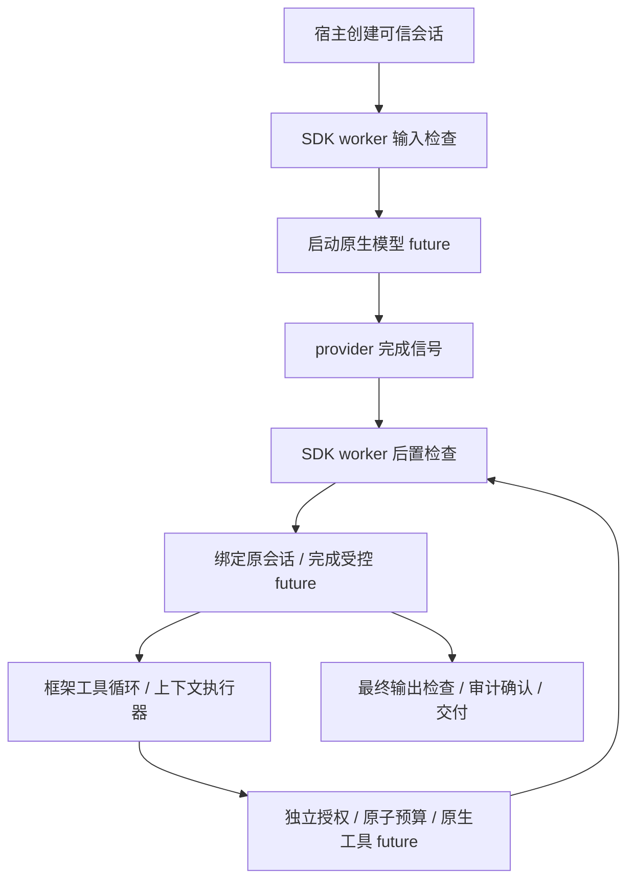

# 异步与并发工具使用指南

v0.2 在原有治理运行时与适配器上增加 CompletableFuture / CompletionStage，继续使用同一套策略、可信身份、审批、预算和审计。

## 运行示例

```bash
bash scripts/verify.sh
java -jar examples/target/agt-examples-0.6.0-SNAPSHOT.jar async all
# 单独演示取消和同步并发工具
java -jar examples/target/agt-examples-0.6.0-SNAPSHOT.jar async cancel
java -jar examples/target/agt-examples-0.6.0-SNAPSHOT.jar async parallel
```

异步演示包括允许、跨租户拒绝、参数/结果改写、审批、预算耗尽、源 future 取消和同步并发工具七个场景。被拒绝/取消的场景工具副作用必须为零；改写结果为 masked:modified；并发场景两个工具实际重叠执行。

## 异步 AI Services

```java
interface Assistant {
    CompletableFuture<String> chat(String message);
}

try (var audit = new JsonlAuditSink(Path.of("new-audit.jsonl"));
     var control = AgentControl.fromPath(Path.of("policy.yaml"))
             .asyncLimits(new AsyncLimits(4, 128))
             .audit(audit)
             .build()) {
    var assistant = new LangChain4jGovernance(control)
            .aiServices(Assistant.class)
            .chatModel(model)
            .tools(tools)
            .build();
    try (var session = control.openSession(identity)) {
        String answer = assistant.chat("查询资料").get(30, TimeUnit.SECONDS);
    }
}
```

支持 `CompletableFuture<String>`、`CompletionStage<String>` 以及对应的 AiMessage 类型。raw future、通配符/复杂泛型、Publisher 和多模态仍拒绝。TokenStream 需使用独立的 [严格缓冲流式入口](streaming-guide.md)。模型必须实现原生异步接口；同步模型不会被偷偷搬到 HTTP 完成线程。

HTTP / 异步服务无需用 get 阻塞请求线程来关闭会话，可以直接返回由 SDK 管理生命周期的 future：

```java
return control.withSessionAsync(identity, () -> assistant.chat(message));
```

withSessionAsync 创建不占用调用线程绑定的会话，源 future 完成/失败/取消后记录 shutdown 并关闭会话，再结束返回的 future。返回 future 正常完成时会话已经关闭，后续调用需新建会话。会话创建/startup 仍有同步校验与审计；在要求完全非阻塞的事件循环中，应把这一入口交给宿主的有界执行器。

高级生命周期控制可以使用 openDetachedSession，再通过 bind 启动受控调用；detached 会话可在完成线程关闭。普通 openSession 保留在创建线程关闭的约束。

手动管理的会话必须活到顶层 future 完成。退出 try-with-resources 会取消未完成工作；不要在启动异步调用后立即关闭会话。一个会话只允许一个顶层调用，但工具可以并发；第二个重叠的顶层调用会终止该会话。

`future.get(timeout)` 超时只结束调用者等待，不自动取消任务；需要主动停止时调用 `future.cancel(true)` 或 `session.revoke()`。SDK 的会话期限另有定时器，源 future 永不完成时也会使受控结果失败。

## 异步工具与并发

`@Tool` 支持同步 String/void，以及 CompletableFuture/CompletionStage<String 或 Void>；调用方法和治理检查在有界工作池上执行，方法返回的 future 被原生框架组合。方法本身应尽快返回；真正的异步 I/O 由宿主工具实现。

自定义 ToolExecutor 需实现 `executeAsync(request, context)`。默认接口未实现异步时返回 `tool_async_unsupported`，不回退执行同步方法。`execute`、`executeWithContext`、`executeAsync` 都使用统一的工具许可与参数约束，并保留原生 InvocationContext 与请求 ID。

同步 AI Services 默认仍顺序执行工具，显式启用并发：

```java
var assistant = adapter.aiServices(Assistant.class)
        .chatModel(model)
        .tools(tools)
        .executeToolsConcurrently()
        .build();
// 或 executeToolsConcurrently(hostExecutor)，宿主负责关闭自己的执行器。
```

原生异步 AI Services 的工具按 LangChain4j 1.20.0 行为允许并发，使用 SDK 提供的上下文执行器。每个工具独立预占预算、检查权限和审批；多个工具不是原子事务，一项拒绝时其他已开始工具可能产生副作用。后续调用和所有未交付结果都会被终止状态阻止。

## 上下文与执行流程



每个受控 future 在创建时捕获会话，正常完成信号恢复该会话，再触发框架后续流程。临时绑定在 finally 中恢复原值，线程复用不会继承前一个用户的身份。

高级装饰器支持 ChatModel.chatAsync / doChatAsync 和 ToolExecutor.executeAsync。普通 Java 可使用 `control.runAsync` 或 `session.operationAsyncPrepared`；后者分别提供纯形状恢复、执行和输出投影，以确保执行前失败释放预算。

应用自己的异步任务可用 `control.contextualExecutor(hostExecutor)` 或 `try (var scope = session.bind())`。这些接口只传播上下文，不治理任意 Runnable、HTTP 或数据库操作；实际受控入口会检查绑定会话有效性。即使任务已排队而会话已关闭，受控入口也会在 CompletableFuture 任务内部失败，而不是让排队的 future 永不结束。

成功回调可读取 `control.currentSession()`；失败/取消后受控入口已不可用，关联 ID 使用此前保存的 session.sessionId()。不要在未指定执行器的 thenApply/whenComplete 中执行长时间阻塞逻辑，使用 thenApplyAsync 等接口以及宿主管理的执行器。任意用户回调、策略、工具代码不响应中断时，SDK 不保证强制终止该代码。

## Memory / RAG 的边界

Builder 的 ChatMemory、ChatMemoryProvider 和 RetrievalAugmentor 增加上下文/取消桥。支持原生 async 方法；若 Memory/RAG 明确返回 AsyncNotSupportedException，则在 SDK 有界工作池执行对应同步方法，不使用不带上下文的默认线程池。

这是框架 I/O 适配，**上下文桥本身没有检索前 ACL 或记忆读写授权；v0.4 使用独立的 [显式数据绑定](data-guide.md)**。预算只计模型/工具，不把 Memory/RAG 桥接任务记为模型调用。历史和增强内容仍在模型前进入完整消息检查。宿主负责会话数据隔离与真实存储权限。

## 容量、取消与审计

| 配置/行为 | 默认与边界 |
|---|---|
| AsyncLimits.workerThreads | 默认 4；可设 1..64 |
| AsyncLimits.queueCapacity | 默认 128；可设 1..4096 |
| 工作池满 | `async_capacity_exceeded`，终止该会话，不能转为放行 |
| 会话期限 | 沿用 budget.maxDurationMillis；期限定时器由 runtime 管理 |
| 失败审计 | 独立 1 线程，有界队列容量使用 queueCapacity |
| 失败审计队列满/写入失败 | runtime 级 `audit_failed`，禁止新动作 |
| runtime close | 取消在途工作，关闭自有池；失败审计最多等待 5 秒排空，超时中断 |

成功的前后检查和结果交付依然要求审计同步确认。取消/失败的 EXECUTION 记录异步写入，可能晚于异常 future；完整读取需等 runtime 关闭排空。审计宿主应提供有限 I/O 超时，不能靠 SDK 停止任意自定义阻塞 sink。

取消向适配接口返回的源 future 传播，但不能保证框架内部所有衍生 future、工具自建线程或外部副作用响应取消。特别是原生 DefaultToolExecutor 对 @Tool future 的内部组合，SDK 不声称强制取消它的所有内部工作；需要工具实现自己的取消协议。晚到的结果仍不会通过已终止的会话交付。
