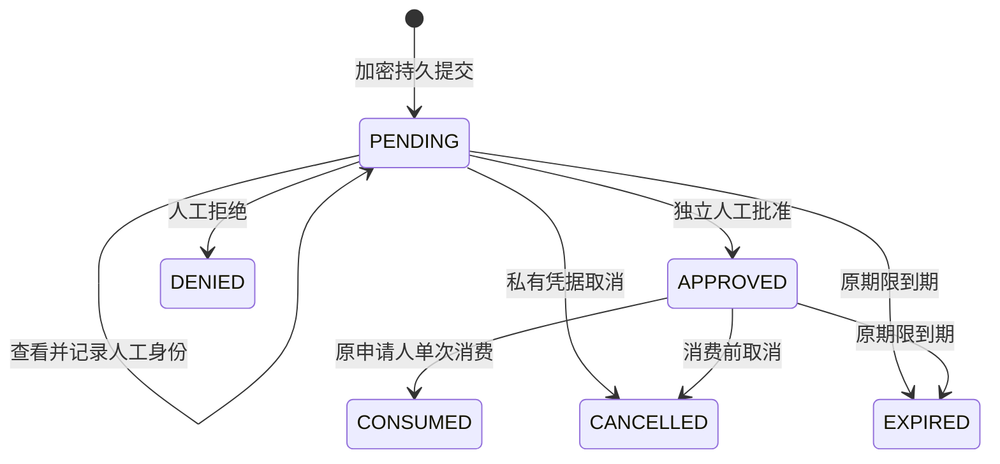

# 已认证的持久人工审批

可选模块 `agt-approval-jdbc` 通过既有 `ApprovalResolver` 接入工具审批：持久保存加密待审动作，由同一租户的另一位已认证人工查看、决策，申请者凭私有能力单次消费批准。数据库提交与独立见证确认完成后，才交付正文或批准响应。

这是有界 SDK 审批的实验实现，尚未为教学网页添加企业登录、审批工作台或跨进程任务恢复。审批消费表示授权已经使用，不表示业务成功；进程在消费后退出时，可能实际没有执行任何业务，仍不能再用同一批准重做。

## 方案检查与复用

本阶段承接[身份接入选型](authenticated-identity.md)：复用 Apache-2.0 的 Nimbus 验签、现有 `AuthenticatedActor` 和核心动作摘要；Keycloak、Spring Security 仍由宿主身份入口集成，没有在此模块中部署。完整长时用户任务可使用 [Flowable User Task](https://www.flowable.com/open-source/docs/bpmn/ch07b-BPMN-Constructs#user-task)（Apache-2.0）；它需要流程引擎、独立数据模型和任务恢复机制，本次有界工具审批没有引入完整引擎。

存储沿用项目 JDBC 协调和独立 `AuditWitness`/`JdbcAuditWitness` CAS 接口，模块因此依赖 `agt-audit-jdbc`；审批记录保存于独立审批表，不混入审计库正文。标准 AES-256-GCM、HMAC-SHA256 与摘要封装抽到核心 `StorageCrypto`，保留旧审计密文格式，并用原生 JCA 生成/读取旧格式测试双向兼容。没有自行实现签名或加密算法。

H2 用于本地事务、并发与多 JVM 验收；生产数据库、连接池等待上限和独立见证管理域仍须部署验证。本阶段没有把本机 H2 测试作为数据库方言或高可用认证。

## 必须成立的绑定

- **申请人**：使用 `AuthenticatedActor`，身份规则必须与审批策略完全一致，具备固定申请权限；动作 context 的租户、主体、权限必须等于认证身份。原始 JWT 不持久化。
- **实际动作**：只接受策略中明确要求审批的 PRE_TOOL_CALL，重新计算 `ActionIdentity`，校验策略版本、工具权限、最终参数以及策略中的副作用规则。会话、动作、参数、业务意图和预期业务状态参与动作摘要。不能仅提交任意字符串摘要来获得批准。
- **审批人**：同一身份规则、同一租户、另一主体、该工具固定审批权限，以及在线有效的近期人工 MFA 声明。申请人兼有审批角色也不能自批。不同账号不证明属于不同自然人；身份源仍需管理账号归属与职责分离。
- **查看凭据**：先提交 VIEW 事件并确认见证，再交付完整请求与随机查看凭据。决策绑定当前查看版本、同一审批主体、同一访问令牌身份、原始完整请求和凭据。再次查看会使旧查看凭据失效；读取元数据收据不会改变已查看的参数版本。
- **消费凭据**：申请者持有随机私有 `ApprovalClaim`，库中只保存其摘要；批准必须由原申请令牌、原身份上下文和同一私有凭据消费。令牌刷新后需重新发起审批，不能自动接管旧任务。

人工 MFA 只验证受信签发者的声明，不证明真人看懂了页面。审批 UI 应显示完整有效参数、业务意图与预期状态，不能用一个通用“确认”按钮替代具体动作。宿主不得把原始 ApprovalRequest、消费凭据或查看凭据广播到普通 Trace 页面。

## 状态与失败语义



DENIED、CONSUMED、CANCELLED、EXPIRED 不能重新转为批准。进入这些终态时删除当前加密记录中的完整请求正文，保留动作摘要、主体、操作事件和历史检查点摘要。备份、WAL 和持有旧密钥的副本仍可能包含旧密文，这不是即时密码销毁。

PENDING/APPROVED 的期限不超过原 SDK 请求、配置最大等待期和申请令牌剩余期限。取消由私有消费凭据授权，只撤回请求，不恢复已撤销身份。每次业务边界与正文/批准交付后段重查身份；见证确认期间身份被撤销，也不交付结果。已经发生的业务不能由撤销回滚，人工已签发决策也不会因其之后退出登录而自动撤回。

活跃身份使用单调计时，持久记录保留不回退的已观察时间；跨节点与重启后的绝对期限仍依赖宿主可信 UTC 和保留的检查点，不提供独立可信时间服务。已持久进入 EXPIRED 的请求不能通过回拨时钟恢复。

每条审批记录绑定 catalog、配置摘要、requestId、修订、密钥版本和上一检查点。独立见证只能推进一条：主库已提交但见证尚未确认时，后续访问可补确认当前这一条，不能恢复旧业务。缺失或领先于主库的非初始见证、有效旧主库快照回滚、错误密钥、损坏密文和不一致配置均拒绝。另一实例已正常推进时，必须从当前已见证密文中的有界历史摘要证明原写入属于其历史，才能确认原操作。

消费提交后响应丢失，同一批准不能再次返回 allow。消费者在见证确认前被强制终止时，新进程只补确认 CONSUMED，然后拒绝重做；业务可能从未执行。审批和业务不是同一分布式事务，需结合[可靠副作用日志](reliable-effects.md)及真实后端幂等/核对能力，不能用“重新审批一次”作为未知业务结果的自动重试策略。

## 配置与宿主接入

`ApprovalPolicy` 没有默认身份源、角色或工具；固定配置在同一 catalog 下不可静默变化。

| 字段 | 范围与含义 |
| --- | --- |
| identityPolicyId / runtimePolicy | 已审核 IdentityPolicy.identity() 和不可变结构化运行策略快照 |
| requesterPermissions | 1–16 个必需申请权限，全部满足 |
| reviewerPermissions | 1–128 个明确需要审批的工具，每工具 1–16 个必需人工审批权限 |
| maxRequests | 1–10000，保留记录总量，包含终态墓碑；满后拒绝新请求 |
| maxRequestBytes | 1024–65536，完整请求 JSON 字节限制；单条加密状态另有 128 KiB 硬上限 |
| maxPendingMillis | 1000–300000 毫秒；仍受原 SDK 期限和令牌期限限制 |
| maxReviews | 1–16，每请求最多重新查看次数；事件历史上限为该值加 8，达到边界拒绝新增事件 |
| maxWaiters / pollMillis | 每个 resolver 实例 1–32 个有界等待名额，50–1000 毫秒轮询间隔；工作线程与队列同样有界，宿主仍须限制实例总数并及时关闭 |

SQL statement 超时由构造器显式设置为 1–30 秒。宿主还应为 DataSource 配置连接数与获取连接期限；statement 超时不能限制任意连接池阻塞。身份查询拥有自己的有界线程与期限，审批不新增无限线程。

以下变量由可信宿主初始化：主库与独立见证库数据源、版本化 `StorageKeys`、已认证申请人 `requester`、固定 IdentityPolicy 和 StructuredPolicy。独立见证库必须使用独立管理/写入权限；只换一张表或库名不能证明独立信任域。

```java
var approvalPolicy = new ApprovalPolicy(identityPolicy.identity(), policy.document(),
        Set.of("approval:request"),
        Map.of("transfer", Set.of("approval:decide")),
        1000, 65536, 30000, 4, 4, 100);
var witness = new JdbcAuditWitness(independentWitnessDataSource, 2);
// 部署阶段显式调用 witness.initializeSchema() 和 store.initializeSchema()。
var store = new JdbcApprovalStore(primaryDataSource, "tool-approvals",
        reviewedCatalogId, approvalPolicy, storageKeys, witness, Clock.systemUTC(), 2);
try (var resolver = new JdbcApprovalResolver(store, requester);
     var control = AgentControl.builder(policy).audit(hostAuditSink)
             .approvalResolver(resolver).approvalTimeout(Duration.ofSeconds(30)).build()) {
    // 用 requester.permit(...) 创建已认证会话，然后调用受控工具。
    // 宿主管理入口仅向正确租户公开待审 requestId，不直接交付原始动作正文。
}
```

示例策略必须实际注册 `transfer` 为 `approvalRequired=true` 的工具，申请者角色须包含其业务权限及 `approval:request`，人工审批角色须映射 `approval:decide`。宿主应复用审批库、密钥提供者与身份验证器；resolver 绑定申请人并显式关闭，不能把一位用户的 resolver 用于其他用户。`AgentControl.close()` 不负责关闭宿主共享资源。

人工入口在完成真实 Web 身份认证后调用：

```java
ApprovalReview view = store.review(authenticatedReviewer, requestId);
// 向该审批人显示 view.request() 的完整有效动作，妥善绑定查看凭据。
store.decide(authenticatedReviewer, view, true); // false 为拒绝
```

SDK 等待器异步提交并轮询，返回的 stage 取消或 resolver 关闭时尝试取消原请求。清理失败不会恢复旧任务，请求仍受原期限约束；宿主应定时调用受信管理方法 `store.expirePending()`，清除未被再次访问的过期正文。该方法只终止请求，不授予执行权限，也不是匿名 HTTP 管理接口。

`store.receipt(actor, requestId)` 只返回 scoped 元数据和操作事件，并先持久追加 RECEIPT 访问事件。它不是无限轮询接口；事件历史满后会拒绝新增访问事件。原始申请者可以读取自己的收据；其他人仍需满足同租户、独立人工与工具审批权限。没有跨租户管理员通配接口。

## 验收与限制

测试验证两个独立 SDK JVM 共享 H2 主库/见证，并访问真实回环 HTTP 业务后端：两个进程竞争同一批准，实际业务请求只有 1；消费提交、见证尚未确认时强制终止工作 JVM，后续进程补确认并拒绝重做，业务请求为 0。两个逻辑数据库位于同一本地测试服务器，未验证生产独立管理域、主库服务器重启或灾备部署。

另覆盖真实核心工具等待、人工拒绝与超时、主体/租户/角色/MFA 边界、动作与副作用意图篡改、查看凭据和消费凭据重放、令牌撤销竞态、损坏密文、主库旧快照、见证故障、双实例确认竞态、实际正文清除、过期清理、存储与等待容量，以及审计旧密文兼容。结果见[结构化证据](evidence/durable-approval-governance.json)。

待完善的生产工作包括：外部 IdP 与 MFA 配置、登录/CSRF/审批工作台、任务恢复协议、审批队列管理、密钥轮换运营、生产数据库与连接池/高可用验证、墓碑归档和配置迁移，以及已发布审批的业务级撤回规则。当前无自动归档或目录轮换，达到容量后明确拒绝；不能删除墓碑或见证来“腾空间”。供应链工具版本审核仍按总计划继续推进。
