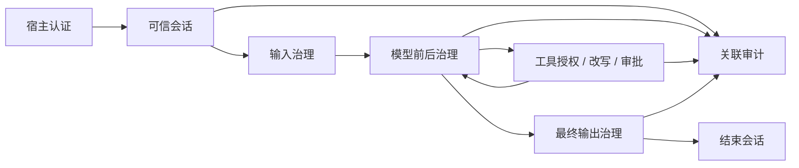

# Agent Governance Toolkit for Java

以微软 AGT 的治理运行时与适配器方式，为 LangChain4j 同步/异步文本 Agent 提供策略执行、可信身份、工具权限、改写、审批、预算和审计。

先读 [使用指南](user-guide.md) 跑通示例，异步接入读 [异步与并发工具](async-guide.md)，流式接入读 [严格缓冲流式](streaming-guide.md)，数据权限读 [RAG 与记忆治理](data-guide.md)，再读 [架构与扩展](architecture.md) 理解干预点与 SPI。完整目标见 [需求规格](requirements.md)，已验证行为与边界见 [当前验收报告](data-verification.md)。

