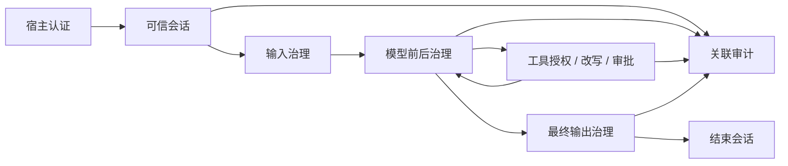

# Agent Governance Toolkit for Java

以微软 AGT 的治理运行时与适配器方式，为 LangChain4j 同步/异步 Agent 提供策略执行、可信身份、工具权限、改写、审批、预算和审计。

已有 LangChain4j 应用优先读 [原生配置与自动会话](native-integration-guide.md)，涵盖结构化结果、多模态、Reactive 和默认实时/可选严格流。实时增量是未经最终检查的预览，完整响应及工具仍经治理。

流式局部字面检测已实现，使用见 [接入说明](guarded-streaming-guide.md)，设计见 [流式增量护栏需求](streaming-guardrails-requirements.md)，定义局部字面规则、安全尾部暂存与流式拒绝的交付边界。

先读 [使用指南](user-guide.md) 跑通示例，异步接入读 [异步与并发工具](async-guide.md)，流式接入读 [严格缓冲流式](streaming-guide.md)，数据权限读 [RAG 与记忆治理](data-guide.md)，固定程序调用读 [命令执行治理](command-guide.md)，可选 OS 沙箱读 [当前 SDK 接入](sandbox-guide.md)，再读 [架构与扩展](architecture.md) 和 [关键类与调用机制](key-classes.md) 理解干预点、核心模型与执行机制。完整目标见 [需求规格](requirements.md)，已验证行为与边界见 [当前验收报告](sandbox-verification.md)。

完整的 [OWASP 十大 Agent 风险实验目录](top10-live-cases.md) 已包含 43 个真实模型对照案例，沿用统一配置与完整调用过程展示。
