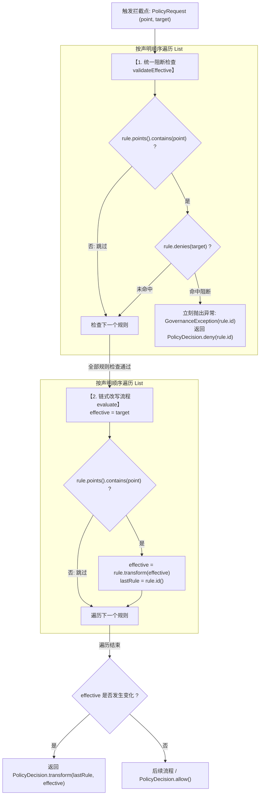
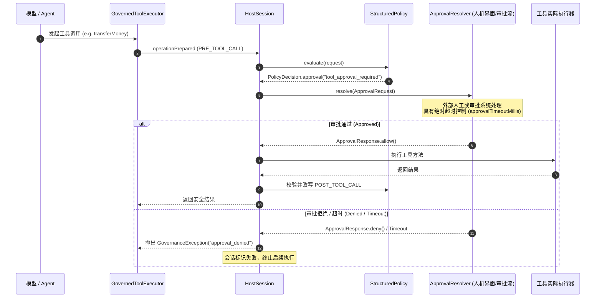

# 关键类与调用机制深度解析

本文档全面梳理并深度解析 `agent-governance-toolkit-4j` (agt4j) 代码库的核心架构设计、关键类实现及运行期调用机制。

---

## 一、系统全景架构与设计原则

`agt4j` 是专为 Java 生态（特别是 LangChain4j）打造的企业级 **Agent 运行期治理 SDK**，旨在解决大语言模型 Agent 在生产落地中的安全性、合规性与稳定性问题（防越权、防注入、防死循环、数据隔离、人机协同审批、隐私脱敏）。

### 1. 核心设计原则

- **确定性与零代码注入（Deterministic & Zero-Eval）**：策略评估引擎不使用 SpEL/OGNL 等动态表达式，也不产生外部网络调用，全部在单机内存中以纯静态规则进行匹配与校验，根绝注入漏洞。
- **安全失败即会话终止（Fail-Safe & Terminal Session）**：一旦触发安全违规（如越权、未授权参数、注入词拦截），会话将被标记为失败并彻底终止（不可逆），防止恶意状态扩散。
- **强类型与不可变性（Immutability）**：策略一旦加载并完成解析，所有内部结构全冻结（Deep Freeze）；会话状态属于宿主（`HostSession`），策略本身无状态（Stateless）。
- **无审计不治理（Strict Audit Guarantee）**：审计写入若发生底层故障，整个治理运行时会自动熔断并拒绝后续所有请求，杜绝无合规留痕的越界调用。
- **改写后再校验（Post-Transform Revalidation）**：内容被规则改写（如参数脱敏或纠偏）后，必须重新接受全量策略硬约束校验，杜绝“利用改写实现提权”。

### 2. 模块拓扑划分

```
agent-governance-toolkit-4j
├── agt-core          # 治理内核：策略引擎、会话生命周期、配额预算、人机审批、审计日志、命令执行
├── agt-langchain4j   # 适配层：针对 LangChain4j 的模型、流式、工具、记忆、RAG 检索受控装饰器
├── agt-sandbox       # 沙箱隔离层：进程/容器环境隔离的命令后端与故障隔离机制
└── examples          # 生产样例与安全攻击防御演示（覆盖 OWASP Top 10 for LLM / ASI-02 / ASI-05）
```

---

## 二、生命周期干预体系（Intervention Model）

### 1. 干预点定义：`InterventionPoint`

框架定义了覆盖 Agent 运行全周期的 10 个核心拦截点（`InterventionPoint`）：

| 干预点枚举 | 触发时机 | 典型治理行为 |
| :--- | :--- | :--- |
| `AGENT_STARTUP` | 会话开启初始化时 | 校验策略激活状态、启动超时计时器（Deadline） |
| `INPUT` | 用户原始指令进入 Agent | 检查 Prompt 注入、黑名单关键词阻断、会话预算检查 |
| `PRE_MODEL_CALL` | 即将调用 LLM 聊天接口前 | 拦截模型入参，进行上下文敏感词过滤、Token 预算预留 |
| `POST_MODEL_CALL` | LLM 返回响应后 | 校验模型输出、累计 Token/调用次数、模型幻觉防范 |
| `PRE_TOOL_CALL` | Agent 发起工具调用前 | 工具白名单鉴权、参数约束校验、租户绑定检查、人工审批触发、参数改写 |
| `POST_TOOL_CALL` | 工具执行完成返回后 | 工具执行结果脱敏（密钥/PII掩码）、输出安全检查 |
| `PRE_DATA_ACCESS` | RAG 检索或记忆读取前 | 租户/主体数据隔离校验、读写操作权限检查、检索词改写 |
| `POST_DATA_ACCESS`| 数据源读取完成返回后 | 检索文档脱敏、返回条目数量限制（`maxItems` 截断/校验） |
| `OUTPUT` | Agent 最终结果返回给用户前 | 最终文本脱敏、格式合规检查 |
| `AGENT_SHUTDOWN` | 会话关闭/清理时 | 释放异步 Future、刷新并落盘审计日志、资源回收 |

---

## 三、策略引擎关键类

### 1. `StructuredPolicy`
- **定位**：实现了 `PolicyEvaluator` 接口的核心策略引擎，承载整套治理规则。
- **核心数据模型（`Document`）**：
  - `apiVersion`: 必须为 `"agt.java/v1"`
  - `version`: 策略版本号
  - `interventionPoints`: 激活的拦截点集合
  - `budget`: 会话级配额预算限制（`BudgetLimits`）
  - `tools`: 工具白名单与参数校验规则表（`Map<String, ToolRule>`）
  - `contentRules`: 文本内容阻断与脱敏流水线（`List<ContentRule>`）
  - `resources`: 数据访问资源规则表（`Map<String, DataRule>`）
  - `dataLimits`: 数据访问频次及条目限制（`DataLimits`）
- **核心判定逻辑**：
  1. `evaluate(PolicyRequest r)`：调用 `validateEffective` 进行硬拦截，继而执行 `ContentRule` 级联改写，再判定是否触发审批，最终返回 `PolicyDecision`。
  2. `validateEffective(PolicyRequest r)`：对请求执行不可逆硬约束检查，用于初次检查及改写后的防篡改二次重验。
  3. `fromYaml(String yaml)`：集成加固型 YAML 解析器，限制大小 1MB、深度 32，防御实体爆炸（Entity Expansion）。

### 2. `ContentRule`
- **定位**：字面量匹配与改写规则。
- **组成字段**：
  - `id`: 唯一规则名称（触发阻断时作为错误码返回）
  - `points`: 适用的干预点集合
  - `denyContains`: 包含任意指定子串即触发阻断
  - `replacements`: 字符串替换映射（保持 `LinkedHashMap` 声明顺序）
- **核心方法**：
  - `denies(Object target)`：递归检查 String、Map（检查 key 和 value）、List，任意命中立即阻断。
  - `transform(Object target)`：递归改写内容；**仅替换 Map 的 value，不改写 Map 的 key**；具备 **1MB 累计膨胀防护**（防止替换死循环或内存炸弹）。

#### 多个 ContentRule 的调用机制
当策略中配置了多个 `ContentRule` 时：
1. **统一阻断检查（Fail-Fast 快速失败）**：
   按列表顺序依次检查所有匹配当前干预点的规则的 `denies()`。只要遇到第一个命中的规则，立即抛出 `GovernanceException(rule.id())` 终止整个评估，后续规则全部短路。
2. **级联流水线改写（Pipeline / Chained Transformation）**：
   阻断检查全部通过后，前一个规则改写的输出作为下一个规则改写的输入，完成多规则流水线变换。最终裁决的 `reasonCode` 会记录最后一个实际产生改写的规则 ID。
3. **改写后二次重校验（Post-Transform Revalidation）**：
   运行时在执行真实动作前，必须拿着改写后的最终载荷再次调用 `validateEffective`，防止改写过程巧合引入了违禁词或篡改了租户上下文。



### 3. `ToolRule` 与 `ParameterRule`
- **`ToolRule`**：
  - `permissions`: 执行该工具所需的权限集合（如 `read`、`db:execute`）。
  - `parameters`: 参数强约束规则（必须为 `ParameterRule.Type.OBJECT`）。
  - `approvalRequired`: 是否强制阻断并等待人机协同审批。
- **`ParameterRule`**：
  - **闭合对象校验**：所有 Object 均严格**拒绝未知属性**，杜绝未声明的攻击参数渗入工具。
  - **上下文强绑定（`equalsContext`）**：支持将参数字段绑定为 `tenantId`、`principalId` 或 `agentId`，强制模型生成的入参必须等于当前认证会话的身份，从根本上解决 LLM 越权调用工具与跨租户数据篡改问题。

### 4. `DataRule` 与 `DataResource`
- **定位**：RAG 检索源与持久化会话记忆（ChatMemory）的数据治理。
- **规则配置**：
  - `kind`: `RETRIEVAL`（知识库检索）或 `MEMORY`（会话记忆）。
  - `scope`: `TENANT`（租户级隔离）或 `PRINCIPAL`（用户主体级隔离）。
  - `permissions`: 细粒度操作与权限映射，支持 `RETRIEVE`、`MEMORY_READ`、`MEMORY_ADD`、`MEMORY_SET`、`MEMORY_CLEAR`，**各项操作权限互不隐式继承**（如读权限绝不包含写权限）。

---

## 四、运行时与会话控制体系

### 1. `AgentControl`
- **定位**：单例全局治理运行时控制器，管理底层线程池、审计接收端与策略实例。
- **线程池与执行组件**：
  - `workers`: 治理异步任务调度线程池。
  - `approvals`: 审批处理线程池（默认固定并发）。
  - `deadlines`: 会话绝对超时执行器（`ScheduledThreadPoolExecutor`）。
  - `current`: `ThreadLocal<HostSession>`，保存当前线程关联的活跃会话。
- **关键机制**：
  - `openSession(TrustedContext)`：开启绑定当前线程的治理会话。
  - `openDetachedSession(TrustedContext)`：开启独立会话（用于异步 Future 链路，跨线程关闭）。
  - `contextualExecutor(Executor)`：跨线程传递当前会话治理上下文。
  - `emit(AuditRecord)`：审计落盘；若底层存储失败，调用 `sessions.forEach(s -> s.refuse("audit_failed"))` 触发全局紧急熔断。

### 2. `HostSession`
- **定位**：单个业务交互的生命周期与限额状态追踪器，实现了 `AutoCloseable`。
- **状态维护**：
  - `modelCalls` / `toolCalls` / `dataCalls`：精准计数，超过 `BudgetLimits` 或 `DataLimits` 立即抛出异常拒绝。
  - `deadline`: 会话最大存活时间（超时后自动取消所有关联任务并标记会话失败）。
  - `pending`: 保存所有运行中的 `Future<?>`，在会话关闭或失败时统一强制取消。
  - `tokens`: 消费的 Token 审计累计。
- **执行骨架**：
  - `operation(...)` / `operationPrepared(...)`：包裹工具/模型/数据调用的核心治理骨架方法，串联“调用前拦截 -> 审批解析 -> 原生委托执行 -> 调用后脱敏 -> 异常包装 -> 审计落盘”。

### 3. `TrustedContext`
- **定位**：经上游宿主认证后注入的可信上下文。
- **字段**：`agentId`、`tenantId`、`principalId`、`permissions`。
- **安全细节**：其 `toString()` 被重写为固定输出 `"TrustedContext[redacted]"`，防止敏感租户或用户标识因应用打印日志而被意外泄露。

### 4. `EnforcementMode`
- `ENFORCE`（默认）：严格阻断与改写模式。
- `EVALUATE_ONLY`（观察模式）：仅评估并记录拒绝/改写审计，不真正打断执行、不改写原数据，常用于策略灰度上线与合规演练。

---

## 五、人机协同审批与安全审计

### 1. 异步人机审批流程



- `ApprovalResolver`：函数式接口，返回 `CompletionStage<ApprovalResponse>`，支持响应式非阻塞审批。
- `ApprovalRequest`：包含 `actionIdentity`（动作摘要哈希）、`policyVersion` 和绝对过期时间戳。

### 2. 结构化审计子系统：`AuditSink`、`AuditRecord` 与 `JsonlAuditSink`

审计系统是 `agt4j` 满足安全合规（OWASP / 内部内控）和安全闭环的关键支柱。它不是可选组件，而是运行时的强制核心依赖。

#### (1) `AuditSink` 接口（SPI 审计接收端）
- **包路径**：`io.agt.core.audit.AuditSink`
- **定义**：继承了 `AutoCloseable` 的单方法函数式接口：
  ```java
  @FunctionalInterface
  public interface AuditSink extends AutoCloseable {
      void write(AuditRecord record) throws Exception;
      default void close() throws Exception {}
  }
  ```
- **核心机制**：
  1. **无审计不治理（No Audit, No Run）**：在 `AgentControl.builder(policy)` 构建时，必须显式提供非空的 `AuditSink`（否则抛出 `NullPointerException`）。
  2. **故障安全熔断（Audit Failure Lockdown）**：若 `write(record)` 在写入时发生任何 I/O 或底层异常，`AgentControl` 判定后续操作无法受控记录，会立即将全局状态置为 `auditFailed = true`，**并遍历当前全部活跃会话执行 `refuse("audit_failed")` 强制终止所有会话**，同时拒绝创建任何新会话，防止在日志失效时发生越权逃逸。
- **扩展与实现形态**：
  - **生产持久化**：使用内置的 `JsonlAuditSink`；
  - **企业级中间件集成**：自行实现 `write(record)` 将其发往 Kafka、ELK、ClickHouse、Splunk 等审计日志平台；
  - **测试断言采集**：以 Lambda 形式（如 `r -> records.add(r)`）收集并验证各干预点是否均被拦截覆盖。

#### (2) `AuditRecord` 记录模型（不可篡改审计快照）
- **包路径**：`io.agt.core.audit.AuditRecord`
- **定位**：Java Record 不可变对象，封装了单次治理拦截或执行的完整数字证据。
- **核心设计机制**：
  - **双记录追踪模型**：对一次工具调用或数据操作，会先后产生两条共享相同 `actionId` 的记录：
    1. **`DECISION` 记录**：在动作发生前产生，记录策略对于该操作的判定（`ALLOW`、`DENY`、`TRANSFORM` 等），此时 `executionOutcome = "not_executed"`；
    2. **`EXECUTION` 记录**：在底层方法执行后产生，明确记录执行结果（`success`、`error` 或执行后脱敏失败导致的 `failed_after_execution`）。
  - **隐私保护与 SHA-256 散列**：审计记录中**绝不保存用户的原始 Prompt、工具调用明文参数或返回值明文**！取而代之的是采用 SHA-256 计算的 `inputIdentity` 与 `enforcedIdentity`。如果发生了数据脱敏或改写，两者的摘要不同，同时 `transformApplied` 标记为 true。
- **全量字段详细字典表**：

| 字段名称 | 类型 | 说明与典型值 |
| :--- | :--- | :--- |
| `schemaVersion` | `int` | 审计规范版本。模型与工具治理为 `1`；包含数据操作（RAG/Memory）的为 `2`。 |
| `timestamp` | `Instant` | 事件发生的绝对 UTC 时间戳（ISO-8601 格式）。 |
| `sessionId` | `String` | 当前会话 UUID，串联单次端到端请求内的全部模型与工具交互。 |
| `agentId` | `String` | 来自 `TrustedContext.agentId()` 的 Agent 身份标识。 |
| `actionId` | `String` | 单次原子操作的唯一 UUID，用于配对该操作的 DECISION 判定记录与 EXECUTION 执行记录。 |
| `point` | `InterventionPoint` | 触发的拦截点枚举（如 `INPUT`、`PRE_TOOL_CALL`、`POST_DATA_ACCESS`、`OUTPUT` 等）。 |
| `mode` | `EnforcementMode` | 执行模式：`ENFORCE`（严格阻断）或 `EVALUATE_ONLY`（旁路观察）。 |
| `policyVersion` | `String` | 判定时所使用的治理策略版本号。 |
| `verdict` | `String` | 策略裁决结果：`ALLOW`、`DENY`、`TRANSFORM`、`EXECUTION`（执行留痕）、`ERROR`。 |
| `reasonCode` | `String` | 判定原因代码。如 `allowed`、`tool_not_allowed`、`permission_denied` 或命中的规则 ID。 |
| `transformApplied`| `boolean` | 内容是否被实际改写（脱敏生效且为 ENFORCE 模式时为 `true`）。 |
| `approvalOutcome` | `String` | 审批结果：`not_requested`、`approved`、`approval_denied`、`approval_timeout`。 |
| `executionOutcome`| `String` | 底层动作实际执行结果：`not_executed`、`success`、`error`、`failed_after_execution`。 |
| `inputIdentity` | `String` | 输入原始内容的 SHA-256 数字摘要。 |
| `enforcedIdentity`| `String` | 最终有效内容的 SHA-256 数字摘要（改写后内容变化时此值与输入不同）。 |
| `durationNanos` | `long` | 本次治理拦截与策略判定的纳秒耗时。 |
| `warnings` | `List<String>` | 触发的非阻断性合规告警代码列表。 |
| `dataOperation` | `String` | （Schema v2 专有）数据访问操作类型：`RETRIEVE`、`MEMORY_READ`、`MEMORY_ADD`、`MEMORY_SET`、`MEMORY_CLEAR`。 |
| `resourceIdentity`| `String` | （Schema v2 专有）被访问的数据资源（如知识库分区、记忆实例）的数字摘要。 |

#### (3) `JsonlAuditSink` 实现类（生产级文件写入器）
- **包路径**：`io.agt.core.audit.JsonlAuditSink`
- **定位**：实现了 `AuditSink` 接口的开箱即用同步文件追加写入器，输出为标准 JSON Lines 格式。
- **安全加固设计**：
  1. **防篡改与覆盖保护**：构造时必须指定一个尚未存在的新文件路径（`CREATE_NEW` 模式）。若目标文件已存在则报错，防止历史审计日志被误覆盖或截断。
  2. **POSIX 权限加固**：创建文件时自动设置权限掩码为 `rw-------`（`600`），严格限制仅当前宿主进程用户可读写，防止操作系统同机其他进程窥探。
  3. **并发安全与实时刷盘**：`write` 方法使用 `synchronized` 保护，允许多个并发 Agent 会话共用一个 Sink 实例；每次写入行记录后强制调用 `writer.flush()` 同步至操作系统底层，最大程度减少机器异常断电造成的日志丢失。

---

## 六、命令安全与沙箱隔离

为防御命令注入与越界执行（ASI-05 漏洞），内核及 sandbox 模块提供了分层命令管控：

### 1. `FixedCommand`
- **二进制完整性检查**：配置时必须提供可执行文件的 `SHA-256` 散列值，运行前实时校验文件哈希，防止二进制文件被篡改或替换。
- **有界参数模板（`CommandArgument`）**：拒绝任意 Shell 拼接，仅允许预定义枚举参数（`namedChoice`）或严格限长/防转义的受限文本参数（`namedText`）。
- **进程资源限制（`CommandLimits`）**：严格限制最大超时时间、标准输出与错误输出的最大缓冲区字节数，并发执行量通过 `Semaphore` 硬性限流。

### 2. `SandboxCommandBackend`
- **宿主/沙箱隔离**：将命令交付至独立的容器或微虚拟机（通过 `SandboxClient`）执行。
- **故障隔离与隔离区（Quarantine）**：如果沙箱任务超时或异常取消，为了防止“无法确认容器内部进程是否完全终止”，该 Backend 实例会被自动标记为 `quarantined`（隔离废弃），拒绝复用，保障宿主系统的物理边界安全。

---

## 七、LangChain4j 适配集成

`LangChain4jGovernance` 是统一适配门面，采用透明代理/装饰器模式对原生 LangChain4j 组件进行治理包装：

| 原生组件 | 受治理包装类 | 核心治理行为 |
| :--- | :--- | :--- |
| `ChatModel` | `GovernedChatModel` | 拦截 `PRE/POST_MODEL_CALL`，检查并合并请求参数，模型输入输出脱敏，Token 消耗累计 |
| `StreamingChatModel` | `GovernedStreamingChatModel` | 使用 `BufferedTokenStream` 进行严格有界缓冲，避免未治理的敏感 Token 泄露 |
| `ToolExecutor` | `GovernedToolExecutor` | 拦截 `PRE/POST_TOOL_CALL`，校验工具权限、参数闭包绑定、触发审批、执行结果脱敏 |
| `ChatMemory` | `GovernedChatMemory` | 拦截 `PRE/POST_DATA_ACCESS`，限制租户/主体记忆的增删改查权限，改写或屏蔽越权记忆 |
| `ContentRetriever` | `GovernedContentRetriever` | 拦截 RAG 检索入口，执行检索词过滤脱敏，并对返回的切片数量执行 `maxItems` 配额限制 |
| `AiServices` | `LangChain4jGovernance.aiServices(...)` | 自动将受控的模型、工具列表、记忆与检索器组装成动态代理服务，提供开箱即用的受控 Agent 入口 |

---

## 八、典型端到端受控示例

```java
// 1. 加载并构建确定性策略 (StructuredPolicy)
StructuredPolicy policy = StructuredPolicy.fromPath(Path.of("policies/agent-policy.yaml"));

// 2. 初始化审计落地组件与治理运行时 (AgentControl)
try (var audit = new JsonlAuditSink(Path.of("audit.jsonl"));
     var control = AgentControl.builder(policy)
             .audit(audit)
             .approvalResolver(request -> CompletableFuture.completedFuture(ApprovalResponse.allow(request)))
             .build()) {

    // 3. 构建 LangChain4j 受治理服务
    var assistant = new LangChain4jGovernance(control)
            .aiServices(OrderAssistant.class)
            .chatModel(model)
            .tools(new OrderTools())
            .build();

    // 4. 注入强认证可信上下文，开启受控会话 (HostSession)
    var userContext = new TrustedContext("agent-order", "tenant-1001", "user-8888", Set.of("order:query", "order:refund"));
    try (var session = control.openSession(userContext)) {
        // 5. 执行业务调用：期间所有模型调用、工具权限校验、参数租户检查、内容脱敏均由治理框架自动拦截驱动
        String response = assistant.chat("帮我查询一下订单 12345 并申请退款");
        System.out.println(response);
    }
}
```
