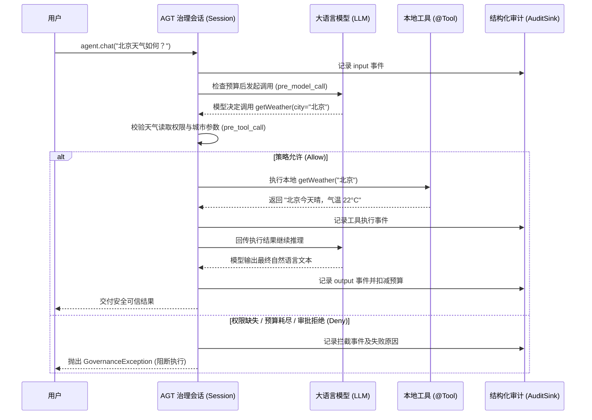

# SDK 使用与配置

## 从示例开始

```bash
mvn -B -ntp -s .mvn/settings.xml -Dmaven.repo.local=.cache/m2 verify
java -jar examples/target/agt-examples-0.6.0-SNAPSHOT.jar all
java -jar examples/target/agt-examples-0.6.0-SNAPSHOT.jar allowed examples/policies/default.yaml
```

可选场景为 `allowed`、`denied`、`transform`、`approval`、`approval-denied`、`budget`。默认策略采用 Java Builder，第二个参数可切换为本地 YAML。`transform` 演示预期结果为 `masked:modified`；使用外部 YAML 时策略以文件为准，该演示仍要求其改写验收条件满足。

## LangChain4j Agent 调用与受控治理对比

在 LangChain4j 中构建 Agent 的核心手段是 **`AiServices`** 与 **`@Tool`** 注解。开发者无需手动编写复杂的提示词和函数调用解析循环，只需声明业务接口和本地方法，LangChain4j 运行时会自动驱动模型完成「思考-行动-观察」（ReAct）闭环。

然而，原生的 Agent 缺乏安全边界（例如模型被提示词注入导致越权调用高危工具、工具陷入死循环耗尽 Token 等）。本节通过对比**原生 LangChain4j 标准写法**与 **AGT 受控治理写法**，说明如何在生产环境中规范且安全地调用 Agent。

### 1. 原生 LangChain4j 标准调用（入门）

#### 步骤 1：定义 Agent 接口
接口用于声明业务交互协议，LangChain4j 运行时将为其动态生成实现：

```java
public interface WeatherAgent {
    String chat(String userMessage);
}
```

#### 步骤 2：定义工具（@Tool）
编写普通的 Java 类，在对外开放的方法上标注 `@Tool` 注解及清晰的功能描述：

```java
import dev.langchain4j.agent.tool.Tool;

public class WeatherTools {
    @Tool("根据城市名称查询当前天气情况")
    public String getWeather(String city) {
        if ("北京".equals(city)) {
            return "北京今天晴，气温 22°C";
        }
        return city + "的天气信息暂未收录";
    }
}
```

#### 步骤 3：配置 ChatModel
声明模型客户端（例如 OpenAI 兼容模型）：

```java
import dev.langchain4j.model.chat.ChatModel;
import dev.langchain4j.model.openai.OpenAiChatModel;

ChatModel model = OpenAiChatModel.builder()
        .baseUrl("https://api.openai.com/v1")
        .apiKey(System.getenv("OPENAI_API_KEY"))
        .modelName("gpt-4o")
        .temperature(0.0)
        .build();
```

#### 步骤 4：组装并执行调用
通过 `AiServices.builder` 组装并触发调用：

```java
import dev.langchain4j.memory.chat.MessageWindowChatMemory;
import dev.langchain4j.service.AiServices;

public class QuickStart {
    public static void main(String[] args) {
        WeatherAgent agent = AiServices.builder(WeatherAgent.class)
                .chatModel(model)
                .tools(new WeatherTools())
                .chatMemory(MessageWindowChatMemory.withMaxMessages(10))
                .build();

        String reply = agent.chat("请问北京今天天气怎么样？");
        System.out.println(reply);
    }
}
```

---

### 2. AGT 受控治理调用（生产级强化）

直接运行原生 Agent 存在显著隐患：
- **无鉴权与权限隔离**：任何输入均可驱动模型尝试调用任何挂载的工具。
- **无预算与频次限制**：模型陷入工具死循环时会持续消耗费用，直到发生底层 HTTP 超时。
- **高危动作缺少审批**：写入、删除或命令执行等副作用动作直接生效。
- **缺少调用审计追溯**：无法获知究竟是哪个用户在什么会话中触发了哪些工具副作用。

通过引入 `agt-langchain4j` 的 `LangChain4jGovernance`，可以在保持原生 `AiServices` 开发体验的同时，为 Agent 注入全生命周期的可信治理：

```java
import io.agt.core.AgentControl;
import io.agt.core.BudgetLimits;
import io.agt.core.GovernanceException;
import io.agt.core.TrustedContext;
import io.agt.core.audit.JsonlAuditSink;
import io.agt.core.policy.StructuredPolicy;
import io.agt.core.policy.ToolRule;
import io.agt.langchain4j.LangChain4jGovernance;
import java.nio.file.Path;
import java.util.Set;

public class GovernedAgentQuickStart {
    public static void main(String[] args) {
        // 1. 声明治理策略：指定工具权限要求与会话预算上限
        StructuredPolicy policy = StructuredPolicy.builder("weather-service-v1")
                .tool("getWeather", new ToolRule(Set.of("weather.read"), null, false))
                .budget(new BudgetLimits(5, 5, 60_000)) // 最多 5 次模型调用、5 次工具调用、60 秒超时
                .build();

        // 2. 初始化治理控制器并绑定结构化审计
        try (var audit = new JsonlAuditSink(Path.of("run-audit.jsonl"));
             var control = AgentControl.builder(policy).audit(audit).build()) {

            // 3. 使用 LangChain4jGovernance 构建受控 Agent
            WeatherAgent agent = new LangChain4jGovernance(control)
                    .aiServices(WeatherAgent.class)
                    .chatModel(model)
                    .tools(new WeatherTools())
                    .build();

            // 4. 在宿主已认证的可信会话（TrustedContext）中安全调用
            // 权限必须来自宿主系统认证结果，而非来自不可信的模型输入
            var identity = new TrustedContext("weather-agent", "tenant-100", "user-01", Set.of("weather.read"));
            try (var session = control.openSession(identity)) {
                String reply = agent.chat("北京今天天气如何？");
                System.out.println(reply);
            } catch (GovernanceException e) {
                // 当权限不足、预算超限或审批被拒绝时，AGT 抛出确定性的治理异常
                System.err.println("调用被安全拦截，原因码: " + e.code());
            }
        }
    }
}
```

---

### 3. 原生 Agent vs. AGT 受控 Agent 对比

| 治理维度 | 原生 LangChain4j (`AiServices`) | AGT 受控治理 (`LangChain4jGovernance`) |
| :--- | :--- | :--- |
| **工具权限管理** | 无权限概念，挂载即全量可用 | 基于 `TrustedContext` 和策略严格检查权限，无权限立即拦截 |
| **参数深度校验** | 依赖模型遵循 JSON Schema，可能发生非法越界 | 支持字段级正则、长度、枚举及 `equalsContext` 跨租户校验 |
| **防死循环与预算** | 仅依赖外部 HTTP 超时，容易消耗大量 Token | 严格控制模型调用次数、工具执行次数及毫秒级会话截止期 |
| **高危动作审批** | 不支持原生人机协同审批闭环 | 声明式 `approvalRequired=true`，异步挂起等待真实终端/人工审批 |
| **内容脱敏与改写** | 需硬编码拦截器或手工处理 | 声明式内容改写规则（前置改写、后置脱敏），支持阻断敏感子串 |
| **执行可追溯性** | 仅有日志打印或模型 listener（存在泄露风险） | 全链路结构化 JSONL 审计，记录输入、决策、工具参数与副作用 |

#### 交互与治理执行时序



## 受控 AI Services 详细接入

先加载策略和必需审计 sink，再构建治理运行时：

```java
var policy = StructuredPolicy.fromPath(Path.of("policy.yaml"));
try (var audit = new JsonlAuditSink(Path.of("new-audit.jsonl"));
     var control = AgentControl.builder(policy).audit(audit).build()) {
    var assistant = new LangChain4jGovernance(control)
            .aiServices(Assistant.class)
            .chatModel(model)
            .tools(myToolObject)
            .build();
    try (var session = control.openSession(
            new TrustedContext("support", authenticatedTenant, authenticatedUser, verifiedPermissions))) {
        String result = assistant.chat("查询资料");
    }
}
```

这些类型分别位于 `io.agt.core`、`io.agt.core.policy`、`io.agt.core.audit`、`io.agt.langchain4j`。`Assistant` 是业务定义的接口，如 `interface Assistant { String chat(String message); }`。应用依赖 `io.agt:agt-langchain4j:0.6.0-SNAPSHOT`，模型客户端由应用单独引入和配置。制品尚未发布到 Maven Central，需执行 `mvn -B -ntp -s .mvn/settings.xml install` 安装到本机默认 Maven 仓库，或使用自己的制品仓库。验证脚本使用的 `.cache/m2` 是隔离缓存，不会自动成为其他工程的默认仓库。

每个线程创建独立会话。`openSession` 绑定当前线程，`close` 恢复之前的会话并清理线程局部引用；应使用 try-with-resources 按嵌套顺序关闭。会话禁止跨线程关闭。可从其他线程撤销会话，但不会自动传播到任意异步任务。

SDK 不验证凭证；`TrustedContext` 必须使用已经认证的身份和权限。不得用模型输出创建此对象。宿主控制会话创建频率与权限来源。

Builder 还支持 `tools(Map<ToolSpecification, ToolExecutor>)`、`tools(List<AiServiceTool>)`、`toolProvider`、`systemMessage`、`chatMemory`、`chatMemoryProvider`、`retrievalAugmentor` 和 `toolExecutionErrorHandler`。提供 executeToolsConcurrently 开启同步并发工具，严格流式配置不启用并发；流式见 [严格缓冲指南](streaming-guide.md)，异步细节见 [异步与并发工具指南](async-guide.md)。工具对象方法支持 String/void 及对应 CompletableFuture/CompletionStage；AI Service 返回 String 或 AiMessage，非可信参数需为 String；@MemoryId 和 InvocationParameters 原样保留。

`@MemoryId` 的行为遵循 LangChain4j，需配置 `chatMemoryProvider`。它是原生框架标识，不是 SDK 的租户授权依据。Memory 与 RAG 此处仅用于组装，读写权限由宿主负责。

## YAML 策略

完整文件位于仓库 `examples/policies/default.yaml`。最小结构：

```yaml
apiVersion: agt.java/v1
version: support-v1
interventionPoints: [agent_startup, input, pre_model_call, post_model_call,
                     pre_tool_call, post_tool_call, output, agent_shutdown]
budget: {maxModelCalls: 20, maxToolCalls: 50, maxDurationMillis: 300000}
tools:
  lookup:
    permissions: [read]
    approvalRequired: false
    parameters:
      type: OBJECT
      properties:
        tenant: {type: STRING, equalsContext: tenantId}
        query: {type: STRING, minLength: 1, maxLength: 200}
      required: [tenant, query]
contentRules:
  - id: redact-result
    points: [post_tool_call]
    denyContains: []
    replacements: {secret: masked}
```

| 配置 | 语义、默认与空值 |
|---|---|
| apiVersion | 必须为 `agt.java/v1`，必填 |
| version | 稳定策略版本标识，必填；修改后需重建 runtime |
| interventionPoints | 明确的干预点集合；完整 Builder 要求八项齐全 |
| budget | YAML 必填；Java Builder 默认模型 20 次、工具 50 次、期限 300000 ms |
| maxModelCalls | 至少 1，按 SDK 模型调用计数 |
| maxToolCalls | 至少 0；0 表示禁止实际工具执行 |
| maxDurationMillis | 1..86400000 ms；不保证中断已执行代码 |
| tools | 缺省/空表示所有工具拒绝，不自动从注册工具生成授权 |
| permissions | 缺省/空表示此工具不要求额外权限；仍要求可信会话 |
| parameters | 必填 OBJECT 规则；required 字段必须存在，所有对象拒绝未知字段 |
| approvalRequired | 缺省 false；true 需要宿主审批器 |
| contentRules | 缺省/空表示无字面内容规则；其他治理仍有效 |
| denyContains | 区分大小写的字面子串列表；缺省/空无内容拒绝 |
| replacements | 字面替换，按规则和映射声明顺序应用；缺省/空不改写 |

参数 `type` 支持 STRING、INTEGER、NUMBER、BOOLEAN、OBJECT、ARRAY。STRING 支持 minLength/maxLength（Unicode code points）、enumValues 和 equalsContext（tenantId/principalId/agentId）；NUMBER/INTEGER 支持 minimum/maximum/enumValues；OBJECT 支持 properties/required；ARRAY 必须提供 items，并支持 minLength/maxLength（元素数）。不做字符串到数字等类型转换；这些规则不是完整 JSON Schema。

先检查原始参数的授权和内容硬约束，再应用改写，之后再次检查有效参数。改写不能用于修复已拒绝的越权动作。多个内容规则的拒绝不能由其他规则的放行或改写覆盖。

单份配置和 JSON 文本上限为 1048576 字符；文件加载还检查字节大小。JSON 最大深度 32、单对象/数组 4096 项；程序式 payload 还限制聚合字符预算和节点数，达到边界时可能因治理包装字段开销更早拒绝。改写膨胀也受限。未提供远程策略加载、继承或热更新。

## 审批与观察模式

```java
var control = AgentControl.builder(policy)
        .audit(audit)
        .approvalTimeout(Duration.ofSeconds(30))
        .approvalResolver(request -> approvalBackend.request(request))
        .build();
```

审批 SPI 位于 `io.agt.core.approval`，返回 CompletionStage<ApprovalResponse>。演示可使用 `CompletableFuture.completedFuture(ApprovalResponse.allow(request))`；真实场景由宿主检查审批人身份并返回绑定 requestId/actionIdentity 的结果。请求包含有效动作，可能含敏感信息；不要直接发送到不可信系统或记录完整请求。

默认审批等待 30000 ms，可配置 1..300000 ms，并被剩余会话期限截短。等待在有限的 2 线程/32 排队任务池执行。超时和撤销取消 future；不响应中断的宿主实现可能继续占用线程，后续请求将因超时或容量不足拒绝。runtime close 关闭线程池和定时器，并最多等待 5 秒排空失败审计。AuditSink 的生命周期由宿主管理。

`.mode(EnforcementMode.EVALUATE_ONLY)` 仅观察策略裁决，保留原值，不执行改写/审批或策略拒绝。结构/版本校验、会话期限、预算和审计故障仍会阻止执行，观察模式不是无限制旁路。默认 ENFORCE。

## 独立装饰器与扩展

```java
var adapter = new LangChain4jGovernance(control);
ChatModel guardedModel = adapter.guardModel(model);
ToolExecutor guardedTool = adapter.guardTool("lookup", executor);
try (var session = control.openSession(identity)) {
    ChatResponse answer = guardedModel.chat("查询资料");
}
```

`guardModel` 只覆盖 pre/post_model_call；`guardTool` 只覆盖 pre/post_tool_call；会话负责 startup/shutdown。需要 input/output 时使用受控 Builder，或通过 `control.run(input, callback)` 包裹显式调用。框架无关工具可用 `control.runTool(name, arguments, callback)`。

自定义策略实现 PolicyEvaluator，声明 version 与 interventionPoints，返回 PolicyDecision.allow/deny/transform/approval。`validateEffective` 必须检查改写后的硬约束；`requiresApproval` 用于独立判断有效动作是否仍需审批。实现应当确定、不可变、线程安全，不执行额外 Agent 动作。不要只返回布尔放行结果而丢失改写语义。

成功交付前 AuditSink.write 需要同步确认成功；异步失败的 EXECUTION 记录在独立有界队列写入，runtime close 有界排空。异步 collector 的送达保证由宿主实现。JSONL writer 同步 flush，新文件创建且 POSIX 权限为 0600；不提供多进程协调、轮转、fsync、断电恢复或防篡改保证。

## 错误与边界

GovernanceException.code 返回稳定错误代码。会话终止后的调用通常返回 session_failed，首次终止原因可通过 session.failureCode() 和审计记录读取。不要重试相同已终止会话。预算和动作限制依赖宿主正确控制会话生命周期。

未经检查的原始模型 listener 不受装饰器输出检查保护，因此 guardModel 拒绝带 listener 的原始模型。使用 AuditSink 订阅治理元数据。SDK 不阻止宿主继续调用保留的原始引用，模型内部 HTTP 重试不等同于 SDK 可观察的模型调用；需要硬限制网络尝试时，应关闭 provider 内部重试并由受控入口重试。

## 数据访问权限

v0.4 增加显式 DataResource 绑定、guardRetriever/guardMemory、contentRetriever 与受控记忆 provider。原始 augmentor/memory 上下文桥不自动获得 ACL；接入与限制见 [数据权限指南](data-guide.md)。
